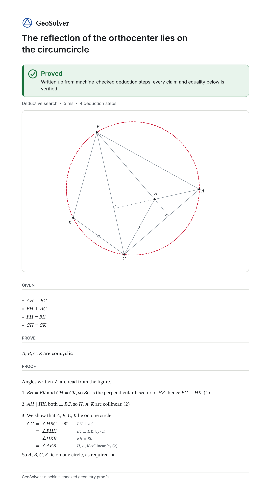

# GeoSolver

**Photograph or describe an olympiad geometry problem → get a full, numbered
proof and a figure — in your browser, inside Claude, or on the command line.**



GeoSolver wraps a fast, from-scratch **Rust** reimplementation of the
**DDAR** symbolic engine from
[AlphaGeometry2](https://www.jmlr.org/papers/v26/25-1654.html)
([`alphageometry-rs/`](alphageometry-rs/)) in a small, self-contained product.
You give it a problem in words or as a photo; Claude turns it into the engine's
`.geo` language; the engine proves it (with a language-model-free auxiliary-point
search, or a classical Euclidean proof for length goals) and draws the figure;
you get the result as a live page, a **PDF**, or a **PNG**.

* **No API key.** Translation runs on **your local Claude subscription** via the
  `claude` CLI — nothing is billed to an API account. The prover and renderer are
  pure Rust and need no network at all.
* **Pure-Rust rendering.** SVG figures are rasterised to PNG (resvg) and exported
  to PDF (svg2pdf) headlessly — no browser, no Python.
* **Three front ends, one engine.** A web app, an MCP server for Claude
  Desktop/Code, and a CLI.
* **Shortest-proof search.** Ask for the *shortest* proof (a time budget, default
  20 s) and it compares every proof it can reach and keeps the one with the fewest
  steps — regardless of how many auxiliary constructions it uses.

---

## How it works

```
 photo / description
        │
        ▼
   Claude (your subscription)  ──►  .geo program
        │                            A B C = triangle
        │                            H = orthocenter(A, B, C)
        │                            K = reflect(H, line(B, C))
        │                            prove cyclic(A, B, C, K)
        ▼
   alphageometry-rs DDAR engine
     • deductive closure  • auxiliary-point search  • classical Euclidean prover
        │
        ▼
   numbered proof  +  SVG figure   ──►   PDF / PNG
```

Relational goals (`collinear`, `concyclic`, `perp`, `cong`, products/ratios of
lengths …) go through the DDAR closure and, if needed, the auxiliary-point
search. **Absolute-length goals** (a specific length, a sum of squares like
`AC² + BD² = 144`) are proved by a **classical Euclidean** prover that writes a
numbered, theorem-citing proof (Pythagoras, Thales, …).

Every result is strictly Euclidean: **proved** means a proof whose every step
cites a theorem or a hypothesis. A length goal no prover reaches is never
reported as proved — it is checked in 48 independently sampled figures and
shown as *Not proven — holds numerically* (evidence, not a proof), or as
*Refuted* with a counterexample. The web API's solve response carries this as
`status`: `"proved"`, `"holds-numerically"`, `"refuted"` or `"not-proved"`,
with `proved: true` only for `"proved"`.

### Human-style proofs

A proved deductive result opens on the **Proof** tab: the proof written the way
a solution is written by hand, in English or Romanian. It names the circles it
uses (Ω, ω₁, …) and introduces auxiliary points in words ("Let F be the foot of
the perpendicular from B to AR"). It is laid out like a marking-scheme (barem)
solution of the Romanian national evaluation or an olympiad: a notation line, a
one-line **plan** ("it suffices to show that …"), then **numbered steps**. Each
step applies one named theorem (perpendicular bisector, midline, Thales,
power of a point, radical axis, law of sines, …) or is one chain of equalities
with **one fact per link** and the reason beside it
(`∠BFA = 90° [BF ⟂ AR] = ∠BNA [BC is a diameter]`). A step that a later step
uses is tagged (k) and cited "by (k)"; the last step restates the goal in the
problem's words ("…, as required. ∎"). Angles written ∠ are the angles of the
drawn figure; directed angles ∡ are used only where a chain must not depend on
the drawing, and are then defined in words together with the steps that need
them. Concyclicity is concluded by a named converse (two right angles on one
segment need no side condition: "the converse of Thales' theorem").
When a fact gives one angle and the chain needs a neighbouring one, the step in
between is its own line (`[angle addition]`, `[exterior angle of △DBL]`,
`[angle sum in △PBC]`), checked like any other link. Setup lines only introduce
objects; they never state anything the proof still has to show.
Trigonometric proofs use the textbook forms `a = 2R·sin A`, `AH = 2R·cos A`
and `OMₐ = R·cos A` (law of sines, extended law of sines, sin(90° − x) = cos x),
each side in at most three lines.

This text is a rewriting of the engine's own derivation; it does not come from a
language model. Every claim, chain link and computation is **re-verified exactly**
against the engine's derivation before it is shown. That means an exact rational
combination of the facts it cites, checked by an independent checker in
`alphageometry-rs/src/human/check.rs`. A block that fails the check is shown as
the engine's raw steps instead. If the conclusion itself fails, or the proof
comes from the classical Euclidean prover (absolute-length goals), there is no
Proof tab and the numbered step list is shown as before.

The figure beside the Proof tab shows only the points the statement and the
proof name. The **Full derivation** tab always has every machine-checked step,
and the figure then also shows the engine's own helper points it cites. The chips in
the Proof tab jump to the steps each block rests on. The PDF report prints the
human proof, and adds the derivation as an appendix when you tick "Include full
derivation" in the Export menu. The MCP tool returns the human proof first, then
the full derivation. The design and the data model are in
[`docs/HUMAN_PROOFS.md`](docs/HUMAN_PROOFS.md).

---

## Quick start

Prerequisites: Rust 1.88+ ([rustup](https://rustup.rs), or your distro's/Nix's `cargo`). Node is only needed for the
optional AI-translation step (below).

### 1. Web app

```sh
./run.sh               # Linux/macOS: builds release, serves on :8787
./run.ps1              # Windows: same, and opens the browser
```

or manually:

```sh
cargo run --release -p ag-studio -- serve --port 8787
# open http://127.0.0.1:8787
```

Type a problem (or paste a `.geo` program, or drop a photo) and press **Solve**.
Download the proof + figure as PDF or PNG.

#### On an iPhone

The web app is built for Safari on iPhone (SE through Pro Max, portrait and
landscape, light and dark):

- **Password once.** A server with a shared password (`AGSTUDIO_BASIC_AUTH`)
  shows a password page instead of Safari's login dialog; the device then
  stays signed in for 180 days. Keychain can save the password. "Forget this
  device" in the footer signs that phone out.
- **Add to Home Screen.** In Safari, Share → **Add to Home Screen** installs
  GeoSolver with its own icon, name and launch screen, and it opens full screen
  like an app. The Home Screen app keeps its cookies apart from Safari, so it
  asks for the password once more on first launch.
- **Photo.** Take a picture or pick one from Photos; the phone shrinks it
  (longest side 2048 px) and removes location data before it is uploaded.
- **Figure.** Pinch or double-tap to zoom, drag to pan. Tapping a step while
  the figure is off screen shows a small copy of the figure with that step lit.
- **Export.** PDF and PNG open the share sheet (Save Image, Save to Files,
  AirDrop) from a "Share / Save" button; SVG shares straight from the menu.
- **Language.** Romanian or English follows the phone's language until you
  pick one with EN / RO.

#### Supported browsers

Safari / iOS / iPadOS 15.4+, Chrome / Edge / Opera 100+ (desktop, Android and
Android WebView), Samsung Internet 17+, Firefox 100+ and Firefox ESR 115.
Newer features (container queries, `:has()`, `color-mix()`, `dvh`, `inert`)
all have fallbacks there. An older browser gets a short "update your browser"
page in English or Romanian instead of a broken app; with JavaScript off the
password page still works and the app says it needs JavaScript. Blocked
cookies, private modes that refuse storage, going offline mid-solve and a
connection that silently stops answering each end in a message that says what
to do, never a spinner that runs forever.

### 2. Inside Claude Desktop / Claude Code (MCP)

Add this to your Claude Desktop config
(`%APPDATA%\Claude\claude_desktop_config.json` on Windows,
`~/Library/Application Support/Claude/claude_desktop_config.json` on macOS; see
[`claude_desktop_config.example.json`](claude_desktop_config.example.json)),
then restart Claude Desktop:

```json
{
  "mcpServers": {
    "alphageometry": {
      "command": "<repo>/target/release/agstudio",
      "args": ["mcp"]
    }
  }
}
```

Now paste a problem (or a photo) into Claude and ask it to prove it. Claude
reads it, writes the `.geo`, calls the `solve_geometry` tool, and shows you the
proof and figure — and can save a PDF with `export_report`. (Build the binary
first: `cargo build --release -p ag-studio`.)

For **Claude Code**:

```sh
claude mcp add alphageometry -- "<repo>/target/release/agstudio" mcp   # agstudio.exe on Windows
```

### 3. Command line

```sh
# Solve a .geo program (or a file) and print the proof:
cargo run --release -p ag-studio -- render alphageometry-rs/examples/orthocenter_reflection.geo

# Solve + export a combined proof-and-figure document:
agstudio render alphageometry-rs/examples/euler_line.geo --title "Euler line" --pdf euler.pdf --png euler.png

# Spend up to 20s finding the SHORTEST proof (fewest steps; auxiliary count irrelevant):
agstudio best alphageometry-rs/examples/olympiad/ortho_reflection_midpoint.geo --budget 20

# Photograph/describe a problem (needs the claude CLI — see below):
agstudio translate --image problem.jpg --solve --pdf proof.pdf
agstudio translate "In triangle ABC prove the medians are concurrent" --solve
```

---

## Enabling AI translation (photo / natural language)

The prover, figures, and PDF/PNG work with **no setup**. To describe problems in
words or photos (rather than writing `.geo` yourself), GeoSolver drives
the local **Claude CLI**, which runs on **your Claude subscription** — no API key:

```sh
npm install -g @anthropic-ai/claude-code
claude            # then run /login and sign in with your Claude subscription
```

That's it — the web app's **Describe** mode and the `translate` command now work.
Optional environment overrides:

| Variable | Effect |
| --- | --- |
| `AGSTUDIO_CLAUDE_BIN` | path to the `claude` executable (if not on `PATH`) |
| `AGSTUDIO_CLAUDE_MODEL` | model to translate with (e.g. `opus`, `sonnet`) |

Inside Claude Desktop/Code (the MCP path) no CLI is needed — Claude itself does
the reading and writes the `.geo`.

---

## The `.geo` language

You describe *how points relate*; the engine samples a concrete figure — you
never write coordinates. Full grammar and worked examples:
[`ag-studio/prompts/geo_grammar.md`](ag-studio/prompts/geo_grammar.md); the
construction/relation catalogue is also printed by
`cargo run -p alphageometry-rs --bin ddar -- --constructions`.

```geo
# Incenter–excenter (trillium) lemma
A B C = triangle
I = incenter(A, B, C)
M = meet(line(A, I), circumcircle(A, B, C))
prove cong(M, B, M, I)
```

Dozens of worked `.geo` examples live in
[`alphageometry-rs/examples/`](alphageometry-rs/examples/), and the canonical
AlphaGeometry problem corpora are preserved under [`corpus/`](corpus/).

---

## Architecture

A Cargo workspace:

| Crate / path | Role |
| --- | --- |
| [`alphageometry-rs/`](alphageometry-rs/) | the DDAR engine (deductive closure, auxiliary-point search, classical Euclidean length prover, SVG figures) — see its own [README](alphageometry-rs/README.md) |
| [`ag-studio/`](ag-studio/) | this product: `engine` (in-process solve wrapper), `render` (SVG→PNG/PDF, report page), `translate` (photo/NL→`.geo` via the Claude CLI), `web` (axum server + UI), `mcp` (MCP server) |
| [`corpus/`](corpus/) | AlphaGeometry problem sets & definitions (for testing / reference) |

The `agstudio` binary has the subcommands `render`, `best`, `translate`, `serve`, `mcp`, `doctor` (checks the AI sign-in with one tiny model call),
`backup` (a consistent copy of the server database) and `--version`.

## Build & test

```sh
cargo build --release            # the agstudio binary + engine
RAYON_NUM_THREADS=6 cargo test --release --workspace -- --test-threads=6   # all tests: the gate
cargo run --release -p alphageometry-rs --bin ddar -- --bench   # engine speed on 26 IMO rows
```

Run the tests in release: that is what ships, and the time-budgeted search
tests are calibrated for it. A debug `cargo test` also works, with the engine's
numeric-consistency assertions on, but skips the ag-studio tests that must find
a proof within a time budget (IMO 2008 P6, the corpus through the API, the
butterfly, the corpus search, a conjunctive goal: `#[ignore]`d in debug
builds). Every FALSE-statement test still runs.

A plain `cargo build --release` targets the host CPU (`.cargo/config.toml`),
appropriate for a locally-run prover. The Docker image and the Nix package are
portable builds; on the benchmark both measure the same within noise
([deploy/DEPLOY.md](deploy/DEPLOY.md#builds)).

## Results

Measured with the corpus benchmark (`ddar --corpus`: the full pipeline, DDAR
then the auxiliary-point search, a hard per-problem deadline, a numbered proof
required), on a shared i7-11700K:

| Set | Budget | Proved | DDAR alone | With aux | Run |
| --- | ---: | ---: | ---: | ---: | --- |
| IMO-AG-30 (development set) | 120 s | **30/30** | 16 | 14 | commit e0a3b04 (release), 4 jobs × 3 threads |
| JGEX-AG-231 (development set) | 30 s | **231/231** | 213 | 18 | commit 0a6e67b, 6 jobs × 2 threads |
| HAGeo-409 (held out) | 120 s | **318/409** (77.8%) | 126 | 192 | commit 4ff884c, frozen engine |
| IMO-AG-50, the 20 beyond IMO-AG-30 (held out) | 120 s | **8/10** expressible | 1 | 7 | commit 4ff884c |
| ISL 2024–2025, IMO 2026 (held out) | 120 s | **10/15** expressible | 5 | 5 | commit 4ff884c |

The two corpora in the first rows were developed against, so they show what
the engine can do, not how it generalises; the held-out rows were run once on a
frozen engine with no tuning, 0 unsound results (report on the `wf/heldout-eval`
branch, `corpus/heldout/REPORT.md`). Two IMO-AG-30 problems are close to the
budget: 2008 P6 took 79 s and 2021 P3 44 s in the e0a3b04 run (94 s and 68 s at 0a6e67b), and earlier
runs at other commits timed out on them (28/30), so a slower or busier machine
can drop them. Soundness is checked separately: the fuzzer
(`ddar --fuzz-false`) turns corpus problems into false statements and fails if
any is proved, and every bug it has found is a regression test.

### Device coverage

Three source-level suites run with `cargo test`; the browser suites run with
Playwright against live servers (setup in
[`ag-studio/tests/CODEMAP.md`](ag-studio/tests/CODEMAP.md)).

| Suite | Covers |
| --- | --- |
| `tests/compat.rs` | Browser baseline (Safari 15.4, Chrome 100, Firefox 100, Samsung Internet 17): late CSS only with a fallback, `:has()` never in a selector list, a media-query copy of every container query, no too-new JS, the old-browser and no-JS notes on every page |
| `tests/mobile_css.rs` | Phone invariants: hover rules, 16 px fields, safe-area gutters, 48 px touch targets, narrow-screen wrapping, Back-button layers |
| `tests/desktop_css.rs` | Tablet/desktop invariants: print stylesheet, figure wheel never trapping scroll, paste/drop, wide and 1024–1199 px columns, contrast and forced colours |
| `tests/compat-inventory.mjs` | Every CSS/HTML/JS feature in `assets/` against MDN compat data for the baseline |
| `tests/webkit/compat-robustness.mjs` | Chromium, Firefox, WebKit: old-browser guard, failed script, JavaScript off, refused storage and cookies, offline and silent connections, slow network, no `inert`, clock skew, memory over 40 solves, server restart |
| `tests/webkit/iphone-layout.mjs` | WebKit, iPhone SE / 15 / 15 Pro Max, portrait and landscape: no sideways scroll, notch gutters, 16 px editor, figure peek, double tap |
| `tests/webkit/iphone-e2e.mjs` | The whole flow on those iPhones, light and dark: password, solve, steps, pinch, PDF/PNG share, AI, Describe, Photo, Romanian, accounts and history |
| `tests/webkit/android-layout.mjs` | Chromium and Firefox at Android sizes from 180 px (page zoom) and the Galaxy Fold cover screen to unfolded, portrait and landscape, light/EN and dark/RO, also at 125/150/200 % text: no overflow, clipping or crowded 48 px targets |
| `tests/webkit/android-e2e.mjs` | The flow on Android: installability, gate, real two-finger pinch, Back closing full screen and the drawer, downloads then Share, clipboard, AI, Photo, Romanian |
| `tests/webkit/desktop-e2e.mjs` | Chromium, Firefox, WebKit on laptops, 1080p and iPads: keyboard-only flow, wheel/Ctrl-wheel/gesture pinch, pen, downloads, clipboard, print media, paste and drop, errors, accounts rail and drawer |

## Deploying on a Linux server

A single binary (UI, fonts, and grammar are baked in) plus one SQLite file for
accounts and history, hardened for public exposure — see **[deploy/DEPLOY.md](deploy/DEPLOY.md)**. The fastest path:

```sh
install -m 600 deploy/.env.example deploy/.env   # set AGSTUDIO_BASIC_AUTH, AGSTUDIO_PUBLIC_HOST
mkdir -p deploy/certs deploy/acme                # a throw-away certificate so nginx starts
openssl req -x509 -newkey rsa:2048 -nodes -days 7 -subj "/CN=localhost" \
  -keyout deploy/certs/privkey.pem -out deploy/certs/fullchain.pem
GEOSOLVER_REVISION=$(git rev-parse --short=12 HEAD) \
  docker compose -f deploy/docker-compose.yml up -d --build
```

Then get the real certificate and set up backups as
[DEPLOY.md route A](deploy/DEPLOY.md#a-docker-compose--nginx-recommended)
describes.

Security defaults: the server **refuses to start on a public interface without
authentication** (a shared password is enough — guests need no account, and
browsers enter it once on a password page that keeps them signed in, while API
clients can still use HTTP Basic), and enforces a per-IP rate limit, a
concurrency cap, a body-size limit, and CSP/security headers. Config is all environment variables
([reference](deploy/DEPLOY.md#environment-variables)). Options include Docker +
nginx (TLS, Let's Encrypt renewal), plain `docker run`, a hardened `systemd`
unit behind Caddy or nginx, and a NixOS module (`nixosModules.default`, with
Tailscale Funnel). The guide covers backup and restore, upgrades and rollback,
sizing, and turning on the AI features with a subscription token.

## Credits & license

Built on a Rust port of the DDAR core of Google DeepMind's AlphaGeometry2.
Apache-2.0. Not an official Google/DeepMind product. Bundled fonts: Inter
(© The Inter Project Authors) and STIX Two Text (© The STIX Fonts Project
Authors), both SIL Open Font License 1.1, and DejaVu (Bitstream Vera and Arev
licences); full texts in
[`ag-studio/assets/fonts/FONT-LICENSES.txt`](ag-studio/assets/fonts/FONT-LICENSES.txt),
also served by the app at `/licenses`. Rust dependencies:
[`THIRD_PARTY_LICENSES.md`](THIRD_PARTY_LICENSES.md). Changes:
[`CHANGELOG.md`](CHANGELOG.md); security reports: [`SECURITY.md`](SECURITY.md).
